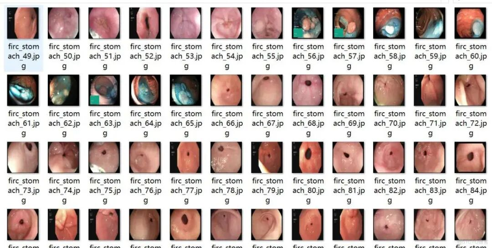
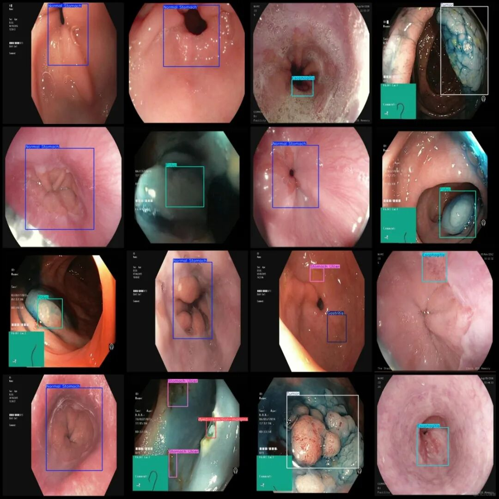

# Intelligent Medical Gastric Diseases, Gastritis, Hemorrhage, and Gastric Tumor Detection Dataset in VOC+YOLO Format with 199 Images in 8 Categories

Dataset format: Pascal VOC format + YOLO format (txt file without split path, only contains jpg images and corresponding VOC format xml files and yolo format txt files)

Number of images (number of jpg files): 199

Number of annotations (number of xml files): 199

Number of annotations (number of txt files): 199

Annotation category count: 8

Label category names (note that the order of categories in the Yolo format does not correspond to this, but is based on the labels folder's classes.txt): ["Esophagitis", "Gastritis", "Hemorrhage", "Normal Stomach", "Polyp", "Stomach Ulcer", "Tumor", "dyed-resection-margins"]

Number of boxes labeled in each category:

Esophagitis (esophagitis) frame count = 28

Gastritis (Gastroenteritis) Frames = 14

Hemorrhage (Bleeding) Frame count = 23

Normal Stomach (normal stomach) frame count = 69

Polyp (Polyp) Frame count = 37

Stomach Ulcer (gastric ulcer) frame count = 41

Tumor (tumor) Frames = 16

Dye-resection-margins (dyed-resection-margins) frame count = 39

Total frame count: 267

Image resolution: 640x640

Using labelImg:

Annotation rules: Draw a rectangle around the category.

Important Notice: No

Special : This dataset does not guarantee the accuracy of the trained models or weight files.

Image Preview:

Annotation example:

## Payment

Here is a pay link on Stripe ( https://buy.stripe.com/3cs8yP7sY87d0vu9AB ). Please contact me lonlonago@foxmail.com after funding $89, and I will send you a complete data files , thank you!

